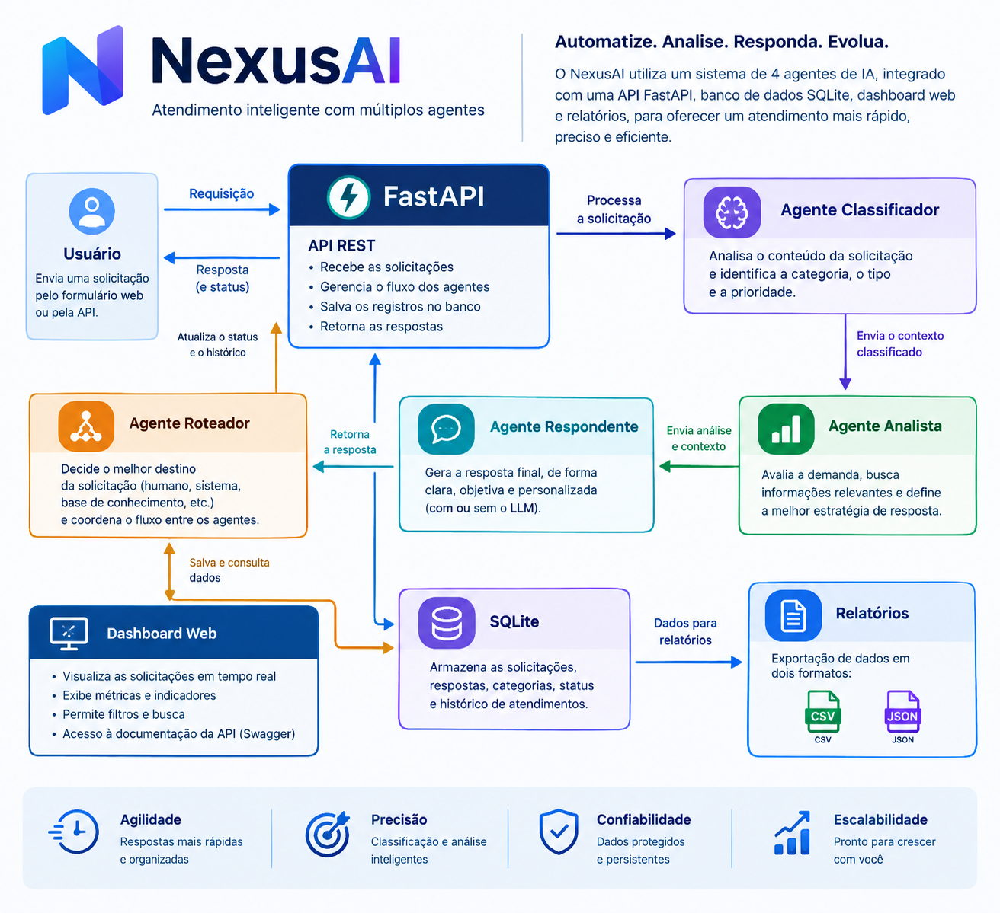

# NexusAI — Plataforma Inteligente de Triagem e Atendimento

<p align="center">
  <strong>Atendimento inteligente com quatro agentes, API REST, SQLite e relatórios.</strong>
</p>

<p align="center">
  
  
  
  
  
</p>

O **NexusAI** é uma aplicação demonstrativa de atendimento inteligente. Ela recebe solicitações por formulário web ou API REST e executa um fluxo com quatro agentes especializados: **classificador**, **analista**, **respondente** e **roteador**.

O sistema pode operar de duas formas:

- **Modo local:** utiliza regras determinísticas e funciona sem chave de API. É adequado para desenvolvimento, demonstrações e testes automatizados.
- **Modo Anthropic:** utiliza a Claude API quando uma chave válida está configurada. Cada agente pode fazer uma chamada independente ao modelo; por isso, o custo depende do número de solicitações, do modelo e dos tokens utilizados.

> **Aviso:** este repositório é um projeto de portfólio. Não o utilize com dados pessoais ou confidenciais reais nem o exponha diretamente à internet sem implementar autenticação, autorização, proteção de dados, rate limiting e monitoramento.

## Arquitetura

O fluxo recebe a solicitação pela API, executa os quatro agentes em sequência, persiste o resultado no SQLite e disponibiliza os dados no dashboard e nos relatórios.



### Responsabilidade dos agentes

1. **Classificador:** identifica categoria, urgência, sentimento e nível de confiança.
2. **Analista:** resume o caso, aponta uma causa provável sem afirmar fatos não verificados e sugere ações.
3. **Respondente:** prepara uma resposta em português brasileiro com o protocolo do atendimento.
4. **Roteador:** encaminha a solicitação ao departamento correspondente e define o SLA demonstrativo.

O pipeline registra um rastreamento (`trace`) com a saída, o modo utilizado e a duração de cada etapa.

## Funcionalidades

- Formulário web para registrar solicitações.
- API REST documentada com Swagger/OpenAPI.
- Pipeline com quatro agentes especializados.
- Modo local por regras, sem necessidade de chave ou chamadas externas.
- Integração opcional com a Claude API da Anthropic.
- Classificação por categoria, urgência, sentimento e prioridade P1–P4.
- Encaminhamento por departamento e SLA definido por regras.
- Persistência dos atendimentos em SQLite.
- Consulta individual por ID, listagem com filtros e paginação.
- Indicadores agregados por categoria, urgência, prioridade, sentimento, departamento e volume diário.
- Exportação dos atendimentos em CSV e JSON.
- Medição do tempo de processamento e rastreamento por agente.
- Testes automatizados com pytest e execução contínua pelo GitHub Actions.
- Script para popular a base com solicitações fictícias sem consumir créditos da API.

## Tecnologias

- **Python 3.10+** — linguagem principal.
- **FastAPI** — API REST e documentação OpenAPI.
- **Anthropic SDK** — integração opcional com Claude.
- **SQLite** — persistência local.
- **HTML, CSS e JavaScript** — interface web.
- **python-dotenv** — carregamento de variáveis do arquivo `.env`.
- **pytest** — testes automatizados.
- **Docker** — execução em contêiner.
- **GitHub Actions** — execução automática dos testes em push e pull request.

## Como executar no Windows (PowerShell)

### 1. Preparar o ambiente

Clone o repositório e entre na pasta do projeto:

```powershell
git clone https://github.com/st4rboy27/nexusai-ai-automation.git
cd nexusai-ai-automation
```

Crie o ambiente virtual:

```powershell
py -m venv .venv
```

Instale as dependências usando diretamente o Python do ambiente virtual. Isso também funciona no Windows quando o comando global `python` não está disponível no PATH:

```powershell
.\.venv\Scripts\python.exe -m pip install -r requirements.txt
```

Crie o arquivo de configuração:

```powershell
Copy-Item .env.example .env
```

### 2. Executar os testes

```powershell
.\.venv\Scripts\python.exe -m pytest -q
```

Os testes automatizados usam o modo local e não precisam de chave Anthropic nem fazem chamadas pagas à API.

### 3. Criar dados demonstrativos

```powershell
.\.venv\Scripts\python.exe -m scripts.seed 20
```

O comando acima cria 20 solicitações fictícias no SQLite e força o modo local para evitar chamadas à API. O script aceita uma quantidade entre 1 e 5000.

### 4. Iniciar a aplicação

```powershell
.\.venv\Scripts\python.exe -m uvicorn app.main:app --reload
```

Acesse no navegador:

| Recurso | Endereço local |
|---|---|
| Dashboard | http://127.0.0.1:8000 |
| Swagger / OpenAPI | http://127.0.0.1:8000/docs |
| Health check | http://127.0.0.1:8000/api/health |
| Resumo dos relatórios | http://127.0.0.1:8000/api/reports/summary |

Para encerrar o servidor, pressione `Ctrl + C` no terminal em que o Uvicorn está executando.

## Usar sem chave de API

Não é necessário criar uma conta Anthropic nem fornecer cartão para testar o modo local. Deixe `ANTHROPIC_API_KEY` vazio no arquivo `.env`:

```dotenv
ANTHROPIC_API_KEY=
```

Nesse modo, os agentes usam regras locais. A resposta da API informa `used_llm: false` quando nenhuma etapa utilizou o modelo remoto. O campo `processing_ms` mede o tempo observado no ambiente local; não deve ser apresentado como benchmark de produção.

## Habilitar a Claude API da Anthropic (opcional)

A chave serve para permitir que o NexusAI envie os prompts dos agentes a um modelo Claude hospedado pela Anthropic. Isso demonstra integração real com um provedor de LLM, em vez de apenas regras locais.

1. Crie uma conta no [Claude Console](https://platform.claude.com/).
2. No Console, abra a área de chaves de API e crie uma chave.
3. Confira a página **Billing** para verificar se a organização possui créditos ou outra modalidade de faturamento habilitada. O uso da API é separado do uso comum do chat Claude; as condições de créditos podem variar conforme o tipo de plano e organização.
4. Abra o `.env` local e configure a chave:

```dotenv
ANTHROPIC_API_KEY=sua_chave_aqui
ANTHROPIC_MODEL=claude-sonnet-5-5
```

5. Use um identificador de modelo disponível para sua conta. Se o modelo configurado não estiver habilitado, ajuste `ANTHROPIC_MODEL` conforme a documentação e o acesso exibido no Console.
6. Reinicie o servidor e teste a conectividade:

```text
http://127.0.0.1:8000/api/health?check_llm=true
```

O retorno `llm_reachable: true` indica que a chamada de verificação alcançou o modelo configurado. Depois, envie uma solicitação e confira `used_llm` e os campos `trace[].used_llm` na resposta.

**Atenção a custos:** o fluxo pode fazer até quatro chamadas ao modelo por solicitação — uma por agente. O consumo é cobrado conforme o modelo e os tokens utilizados. A Anthropic informa que, para a maioria das organizações, o uso é pré-pago por créditos; é possível acompanhar o saldo e o consumo no Billing do Console. Verifique os valores antes de comprar créditos e mantenha o recarregamento automático desligado enquanto estiver apenas experimentando.

**Segurança da chave:** nunca coloque a chave diretamente no código, no README, em capturas de tela ou no Git. O arquivo `.env` está excluído pelo `.gitignore`; publique apenas `.env.example`, sem segredos. Se uma chave for exposta, revogue-a no Console e crie outra.

## API REST

| Método | Endpoint | Descrição |
|---|---|---|
| `GET` | `/api/health` | Estado da API; `?check_llm=true` testa a conexão com Anthropic |
| `POST` | `/api/requests?source=api` | Cria e processa uma solicitação via API |
| `POST` | `/api/requests?source=form` | Cria e processa uma solicitação via formulário |
| `GET` | `/api/requests` | Lista solicitações com filtros e paginação |
| `GET` | `/api/requests/{ticket_id}` | Consulta uma solicitação pelo ID numérico |
| `GET` | `/api/reports/summary` | Retorna indicadores agregados |
| `GET` | `/api/reports/export.csv` | Faz download de CSV |
| `GET` | `/api/reports/export.json` | Faz download de JSON com os atendimentos |

### Exemplo de requisição

```json
{
  "name": "Cliente Teste",
  "email": "teste@example.com",
  "subject": "Cobrança duplicada",
  "message": "Fui cobrado duas vezes pelo mesmo pedido e preciso de ajuda para resolver."
}
```

Exemplo PowerShell, com a aplicação em execução:

```powershell
$body = @{
  name = "Cliente Teste"
  email = "teste@example.com"
  subject = "Cobrança duplicada"
  message = "Fui cobrado duas vezes pelo mesmo pedido e preciso de ajuda para resolver."
} | ConvertTo-Json

Invoke-RestMethod -Uri "http://127.0.0.1:8000/api/requests?source=api" `
  -Method Post -ContentType "application/json" -Body $body
```

A criação retorna `201 Created`, um ID numérico, protocolo, classificação, análise, resposta sugerida, departamento, SLA e rastreamento dos agentes. Para consultar o registro individual, use o `id` numérico retornado — não o protocolo `NX-...` — em `/api/requests/{ticket_id}`.

## Testes e qualidade

Execute todos os testes com:

```powershell
.\.venv\Scripts\python.exe -m pytest -q
```

Os testes cobrem o health check, classificação financeira, encaminhamento de vazamento de dados ao Jurídico, execução dos quatro agentes, medição de tempo, consulta por ID, validação de entrada, resumo dos relatórios e exportações CSV/JSON. Eles rodam sem chave Anthropic.

O workflow em `.github/workflows/tests.yml` executa a suíte automaticamente em push e pull request para `main`.

## Segurança, limitações e próximos passos

- O modo local é baseado em regras e não possui a flexibilidade de um LLM.
- A integração com Anthropic é opcional e depende de uma chave, modelo acessível e créditos ou faturamento habilitado.
- A confiança retornada pelo classificador é uma estimativa, não uma probabilidade estatisticamente calibrada.
- O SLA é demonstrativo e não constitui compromisso operacional.
- Não há autenticação de usuários na versão de portfólio; não exponha a API publicamente sem controles de acesso.
- Para uso real, implemente autenticação/autorização, auditoria, rate limiting, proteção contra prompt injection, gestão de segredos, política de retenção e monitoramento.
- Evoluções possíveis: PostgreSQL, migrations com Alembic, fila de tarefas, autenticação por perfil, avaliação sistemática dos agentes e observabilidade.

## Licença

Distribuído sob a licença MIT. Consulte o arquivo `LICENSE`.
